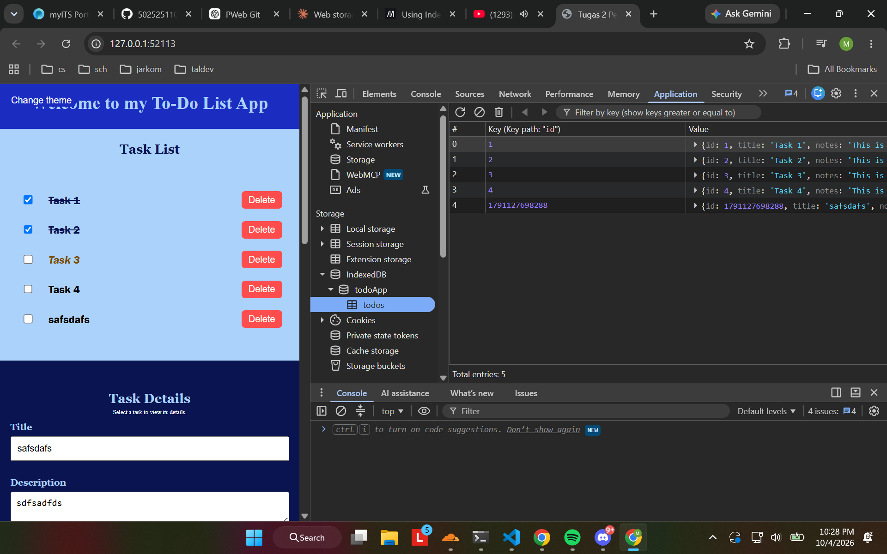
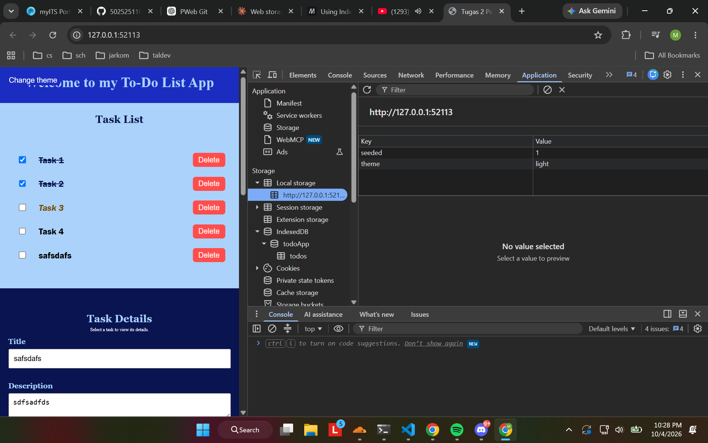
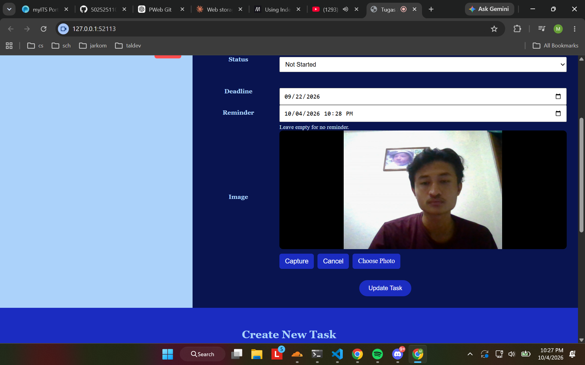

# Tugas3-PWeb
Tugas 3 Week 4 Matkul Pemrograman Web

## Name: Muhammad Ludaka Firdaus

## NRP: 5025251102

## Web Description:
My current webpage is the continuation from the previous task. The main different is my webpage now featuring a web storage that is saved in local web browser. After entering your task, the web will save the data you've entered in your web browser. This works in two mechanisms, which is indexedDB and local storage. Beside that, I also have added new media capture API or camera in my web browser to track the image. However, I still can't make the photo be saved after it captures for every task. There also should be a service worker that will pop you notification but I still haven't finished it yet.

## Preview:

* Change 1 (IndexedDB)

Note: It will save the data you entered in your browser
* Change 2 (Local Storage)

Note: It will save your preferences such as light/theme dark
* Change 3 (Media Capture API)

Note: There will be camera feature in the web browser

